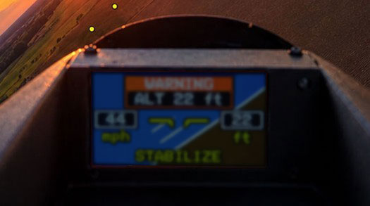
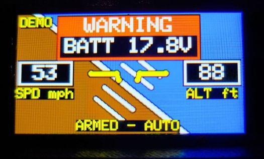

# Cockpit Display by Keith Luneau (aka [Bonafidepirate](https://www.youtube.com/@bonafidepirate))

**An [ArduPilot](https://ardupilot.org/) artificial horizon and flight-status display for the LilyGo T-Display-S3, built to be filmed by your FPV camera.**

A tiny instrument panel for the cockpit of your FPV plane. The ESP32-S3 reads MAVLink telemetry from your flight controller and draws an attitude indicator, airspeed, altitude above home, arm state and flight mode, with a pop-up warning for low battery or low altitude. Everything is drawn thick and outlined so it stays readable when the FPV camera films the screen.

It started as a fun, cosmetic project: a little "glass cockpit" for the camera to look at, styled after the artificial horizon on an FPV OSD. It is **not** a flight instrument. See [Disclaimer](#disclaimer).

## Features

- **Artificial horizon** with sky and ground, roll-following pitch ladder, bank ticks, and a fixed aircraft symbol styled after the one found in the "Clash Bonafide" HD FPV font from [SneakyFPV](https://sites.google.com/view/sneaky-fpv/home). The symbol's bars sit on the horizon when you're level.
- **Airspeed** on the left and **altitude above home** on the right, in your choice of mph, km/h, m/s or knots, and feet or metres.
- **Status line** showing `DISARMED - <flight mode>` on the ground, and just the flight mode in larger text while armed. It reads `Waiting for MAVLINK` if the heartbeat is lost.
- **Pop-up warnings** in a red box: a blinking low-battery warning (total pack voltage), a blinking low-altitude warning, and a steady five-second `ARMED` notice when you arm.
- **Brightness control from an R/C channel**, driving the T-Display-S3's backlight chip the way it is designed to be driven (see [How it works](#how-it-works)).
- **Demo mode** on the board's IO14 button: a simulated flight that needs no MAVLink connection, handy for bench testing and showing it off.
- **All settings in one place** at the top of the sketch, each with its default value in a comment.

## What you need

- [A **LilyGo T-Display-S3** (the standard 1.9-inch, 170 x 320 version, prefer no pins).](https://link.amazon/B0fZTvSfB)
- A flight controller running **ArduPilot Plane** with a free telemetry UART. Flight-mode names are ArduPlane's, including QuadPlane modes.
- Three wires between the flight controller and the display board (see below).
- [Arduino IDE](https://www.arduino.cc/en/software) with ESP32 board support.

## Wiring

| Flight controller | Display board |
|---|---|
| Telemetry TX | GPIO 44 (RX) |
| GND | GND |
| 5V | 5V |

The serial pins and baud rate are settings at the top of the sketch.

> [!WARNING]
> **Do not power the display board from USB while it is wired to the flight controller's 5V.** Two 5V sources connected together risk feeding 5V back into the flight controller. Unplug the 5V wire before connecting USB to program or bench-test the board.

## ArduPilot setup

Set the serial port you used to MAVLink 2 at 115200 baud (`SERIALn_PROTOCOL = 2`, `SERIALn_BAUD = 115`), then set the stream rates for that port. In ArduPilot 4.7 and newer the stream parameters are named `MAVn_...`, where `n` counts the serial ports set to MAVLink: `MAV1` is the first, `MAV2` the second, and so on. Older versions used `SRn_...` names, numbered from 0, such as `SR0_EXTRA1`.

| Parameter | Suggested rate | Message | Used for |
|---|---|---|---|
| `MAVn_EXTRA1` | 10 Hz (20 Hz is smoother) | `ATTITUDE` | Horizon |
| `MAVn_EXTRA2` | 4 Hz | `VFR_HUD` | Airspeed |
| `MAVn_POSITION` | 4 Hz | `GLOBAL_POSITION_INT` | Altitude above home |
| `MAVn_EXT_STAT` | 2 Hz | `SYS_STATUS` | Battery voltage |
| `MAVn_EXTRA3` | 2 Hz | `BATTERY_STATUS` | Battery voltage (this or `EXT_STAT`; one is enough) |
| `MAVn_RC_CHAN` | 10 Hz | `RC_CHANNELS` | Only if brightness is set by an R/C channel |

These are starting points. Keep every stream you use at **1 Hz or faster**, or its readout will show `---`. The heartbeat, which carries arm state and flight mode, is always sent. Altitude is relative to the home position, so it needs a GPS fix. Airspeed is whatever ArduPilot reports in `VFR_HUD`. Without an airspeed sensor that is ArduPilot's own estimate, so treat it as approximate.

## Installation

1. In Arduino IDE, install ESP32 board support and select **ESP32S3 Dev Module**. LilyGo's [T-Display-S3 quick start](https://wiki.lilygo.cc/products/t-display-series/t-display-s3/quick-start.html) lists the recommended board settings.
2. Install these libraries from the Library Manager:
   - **LilyGo-display-library** (LovyanGFX board profiles for LilyGo boards, including the T-Display-S3)
   - **LovyanGFX**
   - **MAVLink** (MAVLink v2 for Arduino)
3. Download this repository (**Code > Download ZIP**) and open `Cockpit_Display/Cockpit_Display.ino`. The folder name must match the sketch name, which it already does.
4. Review the **USER SETTINGS** section at the top of the sketch, especially the units and the warning limits.
5. Connect the board by **USB only**, with the flight controller's 5V wire unplugged, then upload.
6. Wire it to the flight controller and power up. Within a couple of seconds the status line should change from `Waiting for MAVLINK` to the flight mode.

> LilyGo notes that when a board runs without a USB connection, **USB CDC On Boot** should be set to *Disabled* so it doesn't stall at boot waiting for a host. If your display doesn't start when powered from the flight controller, try that setting. You won't see Serial output while it is disabled.

## Settings

Everything you're likely to change is in the **USER SETTINGS** section at the top of the sketch, and every setting has its default in a comment. The ones most people will touch:

| Setting | Default | What it does |
|---|---|---|
| `SPEED_UNIT` | `SPEED_MPH` | `SPEED_KMH`, `SPEED_MS`, `SPEED_MPH` or `SPEED_KNOTS` |
| `ALT_UNIT` | `ALT_FEET` | `ALT_METERS` or `ALT_FEET` |
| `WARN_PACK_V` | 13.2 | Low-battery warning, total pack voltage in volts (3.3 V per cell on a 4S LiPo). 0 disables it |
| `WARN_ALT` | 50 | Low-altitude warning, in your altitude unit. 0 disables it |
| `ARMED_NOTICE_MS` | 5000 | How long the `ARMED` pop-up shows. 0 disables it |
| `BRIGHT_RC_CHANNEL` | 0 (disabled) | R/C channel (1-18) that controls brightness |
| `BRIGHT_RC_LOW_US` / `BRIGHT_RC_HIGH_US` | 1000 / 2000 | Channel values for dimmest and brightest |
| `BRIGHT_MIN` / `BRIGHT_MAX` | 0 / 255 | Brightness range. A minimum of 0 turns the backlight fully off |
| `PITCH_PIXELS_PER_DEGREE` | 5.0 | How far the horizon moves per degree of pitch |
| `LADDER_STEP_DEG` / `LADDER_MAX_DEG` | 5 / 10 | Pitch-ladder spacing and extent |
| `OUTLINE` | 3 | Black outline around every marking, in pixels |
| `T_HORIZON`, `T_LADDER`, `T_BANK`, `T_SYMBOL` | 5, 4, 4, 5 | Line thicknesses in pixels |
| `SKY`, `GROUND` and the other colors | | RGB565 colors |
| `LABEL_TEXT_SIZE`, `STATUS_SIZE_DISARMED`, `STATUS_SIZE_ARMED` | 3, 2, 3 | Text sizes |

Text that would run off the screen shrinks automatically to fit.

## Using it

- **Brightness:** set `BRIGHT_RC_CHANNEL` to a spare channel with a knob or slider that has no ArduPilot function assigned. Set the low and high channel values to match your radio's endpoints.
- **Demo mode:** press **IO14** to start or stop the simulated flight. It rolls and pitches, changes speed and altitude, cycles flight modes, arms after three seconds, and dips below your warning limits so you can see each pop-up. While it runs, real telemetry is ignored. A yellow `DEMO` tag shows in the corner.
- **Warnings:** if both the battery and altitude warnings are active, the pop-up alternates between them. A warning clears once the value rises a little above its limit (5% by default), so it doesn't flicker. The low-altitude warning only becomes active after you are armed and have first climbed above the limit, so it doesn't fire on the ground or during launch.

## Visibility notes

The display is meant to be filmed by an FPV camera, and a few things came up during testing:

- **Camera focus.** Most FPV cameras are fixed focus at infinity, so a screen a few inches away is blurry. That is why markings are thick and outlined and the text is large. A magnifier lens in front of the screen sharpens it, but adds mounting work, drag and glare. Larger text turned out to be good enough for the author.
- **Bright sun.** A small LCD can't compete with direct midday sun, even at full brightness. It reads well in lower light, such as evening flights or overcast days. A hood or shroud around the screen helps keep sunlight off it.

## How it works

- The whole picture is drawn into an off-screen buffer and pushed to the display about 30 times per second, so it doesn't flicker.
- The T-Display-S3's backlight chip (an AW9364) is not a PWM dimmer. It has 16 brightness steps set by pulses on GPIO 38. The sketch drives it directly, with hysteresis and a gamma curve for a more even response across the knob's travel.
- The MAVLink parsing only handles the few messages above, so the sketch stays small and easy to read.

## Troubleshooting

| Symptom | Things to check |
|---|---|
| `Waiting for MAVLINK` | Telemetry TX goes to GPIO 44, the common ground is connected, and the serial port is set to MAVLink 2 at the baud rate in `MAV_BAUD` |
| A readout shows `---` | The stream for that value is enabled at 1 Hz or faster. Altitude also needs a GPS fix |
| Brightness doesn't change | `BRIGHT_RC_CHANNEL` isn't 0, the `MAVn_RC_CHAN` stream is on, and the low and high channel values match your radio |
| Flight mode shows `MODE n` | The mode isn't an ArduPlane mode this sketch knows, or the vehicle isn't a plane |
| Display doesn't start on flight controller power | Try **USB CDC On Boot: Disabled** (see Installation) |

## Disclaimer

This is a cosmetic, for-fun display. Don't use it as a flight instrument, and don't rely on it for navigation or flight safety. It is provided as is, without warranty. Fly safely and within the rules where you live.

## Credits

- **Concept, hardware, testing and direction: Keith Luneau.** The design decisions, the bench and flight testing, and the feedback that shaped every feature.
- **Code and documentation:** written by **Claude**, an AI assistant made by Anthropic, working with **Keith** over a long design conversation. Claude wrote most of the sketch, including the MAVLink handling, the horizon and symbol drawing, the warning logic, the backlight driver, the demo mode, and this README.
- Built on the [LovyanGFX](https://github.com/lovyan03/LovyanGFX) graphics library, LILYGO's LovyanGFX board profiles for the T-Display-S3, and Oleg Kalachev's [MAVLink library for Arduino](https://github.com/okalachev/mavlink-arduino).

## License

[MIT](LICENSE)
